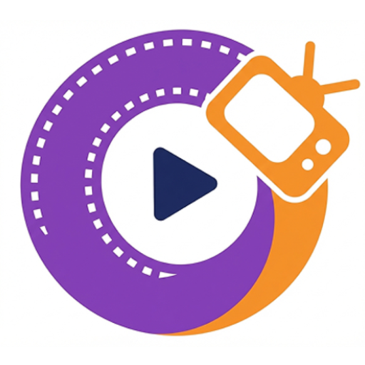

<p align="center">
  
</p>

<h1 align="center">Rewatch</h1>

<p align="center">
  <strong>Android application for discovering and tracking movies and TV shows.</strong>
</p>

<p align="center">
  <a href="https://www.android.com"></a>
  <a href="https://kotlinlang.org"></a>
  <a href="https://developer.android.com/jetpack/compose"></a>
</p>

---

## Overview

Rewatch is an app built to browse movies and TV shows using data from
the [TMDB API](https://www.themoviedb.org/). It allows users to explore trending content, search for
specific titles or people, and manage a personal watchlist.

The project is built with Jetpack Compose for the UI, Hilt for dependency injection, and Firebase
for authentication and data synchronization.

## Features

- **Media Discovery:** Browse trending, popular, and top-rated movies and TV shows.
- **Search:** Find movies, shows, and people.
- **Watchlist:** Track "Watched" and "To Watch" items with Firebase sync.
- **Media Details:** Information including cast, crew, and recommendations.
- **Person Profiles:** Actor and director filmographies.
- **Adaptive Layout:** Support for different screen sizes using Material 3.

## Tech Stack

| Category       | Technology                    |
|:---------------|:------------------------------|
| **Language**   | Kotlin                        |
| **UI**         | Jetpack Compose (Material 3)  |
| **Navigation** | Navigation 3                  |
| **DI**         | Hilt                          |
| **Network**    | OkHttp + Kotlin Serialization |
| **Backend**    | Firebase Auth & Firestore     |
| **Images**     | Coil                          |

---

## Getting Started

### Prerequisites

- A recent Android Studio that supports AGP 9.2
- JDK 21
- A TMDB API key
- A Firebase project with Firestore and Authentication (Anonymous and Email link sign-in)

### Configuration

1. Copy `local.properties.example` to `local.properties`.
2. Fill in your TMDB API key and the values of your Firebase Android app, which you can find in the
   Firebase console under *Project settings > General > Your apps*.
3. Sync Gradle and run the `:app` module.

Without these values the project still compiles, but the app does not work.

---

## Project Structure

```text
rewatch
├── common       # Navigation utilities and shared helpers
├── components   # Reusable UI components
├── model        # Data models
├── screens      # Feature screens (home, search, media, etc.)
├── theme        # Material 3 theme definitions
└── MainActivity # App entry point and navigation host
```

---

<p align="center">
  Developed at <b>Politecnico di Milano</b> • 2026
</p>
