

  <picture>
    <source media="(prefers-color-scheme: dark)" srcset="docs/images/banner-dark.webp" />
    <source media="(prefers-color-scheme: light)" srcset="docs/images/banner-light.webp" />
    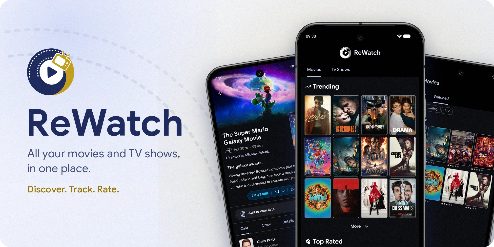
  </picture>

<h3 align="center">An Android app to track the movies and TV shows you watch</h3>

  Discover new titles, keep a watchlist, rate what you've seen and sync your lists across devices.

  
  

  
  
  
  
  

## 🍿 What's inside

  <picture><source media="(min-width: 1140px)" srcset="docs/images/phone-home.png" width="19.2%" /><source media="(min-width: 1012px)" srcset="docs/images/phone-home.png" width="23%" /><source media="(min-width: 600px)" srcset="docs/images/phone-home.png" width="34%" />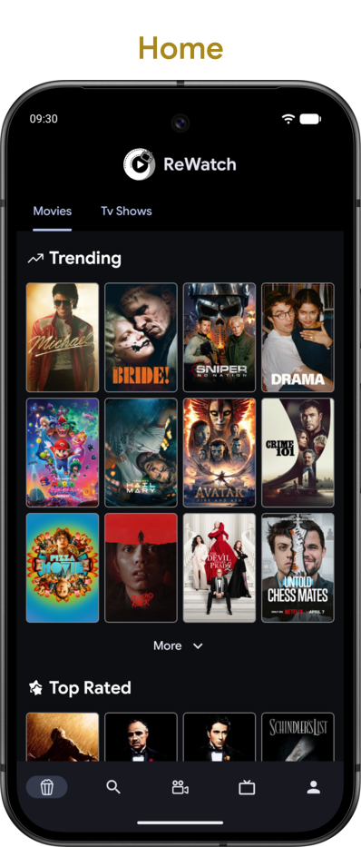</picture><!--
  --><!--
  --><picture><source media="(min-width: 1140px)" srcset="docs/images/phone-details.png" width="19.2%" /><source media="(min-width: 1012px)" srcset="docs/images/phone-details.png" width="23%" /><source media="(min-width: 600px)" srcset="docs/images/phone-details.png" width="34%" />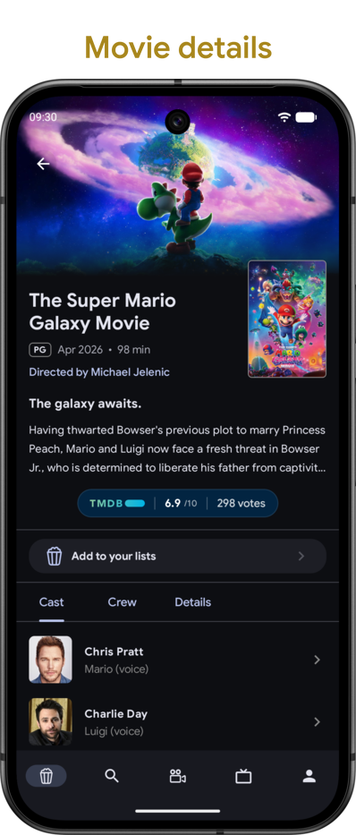</picture><!--
  --><picture><source media="(min-width: 1012px)" srcset="docs/images/spacer.png" width="2.5%" height="1" /></picture><!--
  --><picture><source media="(min-width: 1140px)" srcset="docs/images/phone-search.png" width="19.2%" /><source media="(min-width: 1012px)" srcset="docs/images/phone-search.png" width="23%" /><source media="(min-width: 600px)" srcset="docs/images/phone-search.png" width="34%" />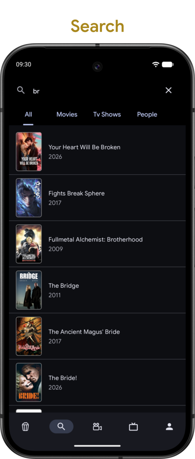</picture><!--
  --><!--
  --><picture><source media="(min-width: 1140px)" srcset="docs/images/phone-lists.png" width="19.2%" /><source media="(min-width: 1012px)" srcset="docs/images/phone-lists.png" width="23%" /><source media="(min-width: 600px)" srcset="docs/images/phone-lists.png" width="34%" />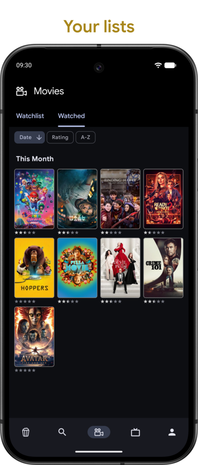</picture>

- **Find tonight's movie.** What's trending, top rated and newest, for both movies and TV shows.
- **Go down the rabbit hole.** Cast, crew, reviews, similar titles and where to watch, right down to a single episode.
- **Search as you type.** Movies, shows and people, with results while your thumbs are still moving.
- **Remember what you loved.** A watchlist and a watched list, with your own stars and watch dates.

And a few more things:

- 🕶️ **No account? No problem.** Start as a guest. Sign in later with an email link, and your lists come along.
- ☁️ **Always in sync.** Your lists live in the cloud and update in real time on every device you sign in to.
- 👆 **Long press, done.** Hold any poster to add it to a list, rate it or set when you watched it.
- 🎭 **People count too.** Actors and directors have their own page, with biography and filmography.
- 📐 **Big screens welcome.** Grids adapt to the space they get, from phones to tablets.

## 🎬 See it in action

We put extra care into the app's smoothness and UI, inspired by the best products on the market today.

  <picture><source media="(min-width: 1012px)" srcset="docs/images/demo-home.webp" width="23%" /><source media="(min-width: 600px)" srcset="docs/images/demo-home.webp" width="34%" />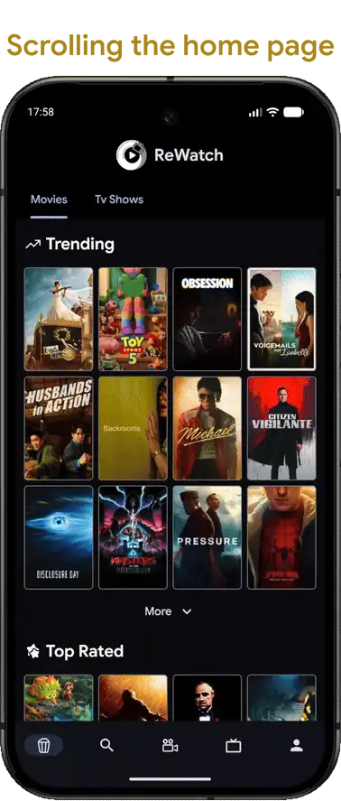</picture><!--
  --><picture><source media="(min-width: 1012px)" srcset="docs/images/spacer.png" width="18%" height="1" /><source media="(min-width: 600px)" srcset="docs/images/spacer.png" width="10.67%" height="1" /></picture><!--
  --><picture><source media="(min-width: 1012px)" srcset="docs/images/demo-details.webp" width="23%" /><source media="(min-width: 600px)" srcset="docs/images/demo-details.webp" width="34%" />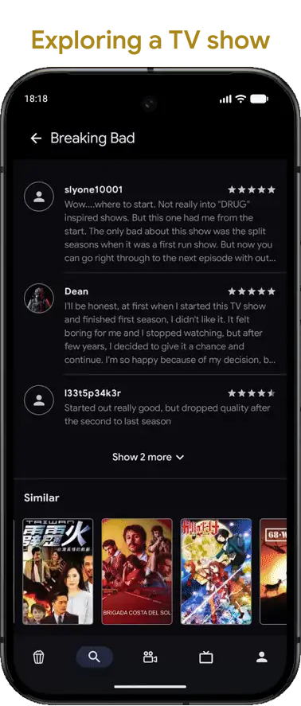</picture>

### On a tablet

  <picture><source media="(min-width: 1012px)" srcset="docs/images/tablet-home.png" width="48.5%" />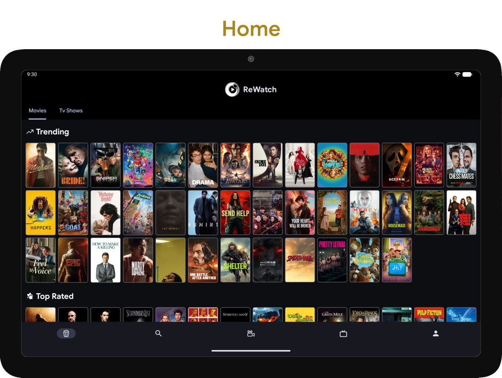</picture><!--
  --><picture><source media="(min-width: 1012px)" srcset="docs/images/spacer.png" width="2.5%" height="1" /></picture><!--
  --><picture><source media="(min-width: 1012px)" srcset="docs/images/tablet-details.png" width="48.5%" />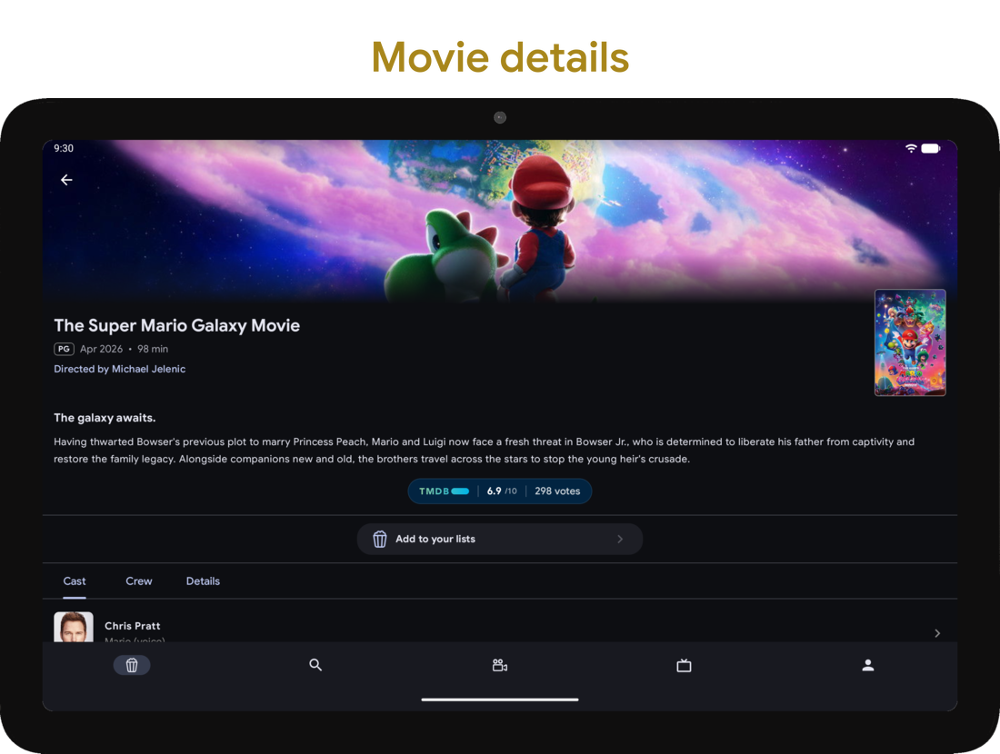</picture>

## 🛠️ Under the hood

100% Kotlin and Jetpack Compose, with a clear split between UI, state and data. Hilt wires everything together, and Navigation 3 handles the typed back stack.

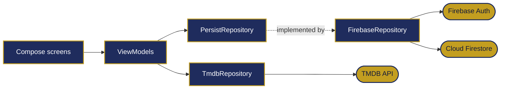

A few parts we enjoyed building:

- **Search that keeps up.** `transformLatest` throws away stale queries. The loading state appears immediately, and the request only leaves after 200 ms of silence.
- **Lists that update themselves.** Firestore snapshot listeners become a `Flow` through `callbackFlow`, shared across the app with `shareIn`.
- **One way to load a screen.** `UiFetchViewModel` gives screens the same loading, success and error states, so each one only says where its data comes from.
- **Skeletons, not spinners.** Home, details, people and lists each have a pulsing placeholder that mirrors their layout.

### From guest to account, without losing a thing

This is our favourite part. A guest is an anonymous Firebase account, created the first time they save something. Signing in uses a passwordless email link that opens the app through an Android App Link. The tricky case is an email that already has an account, because the guest's lists have to go somewhere:

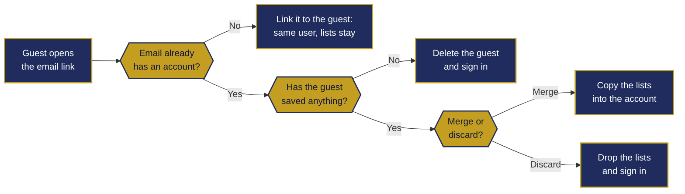

## 🔧 For developers

<table>
  <tr valign="top">
    <td><b>Requirements</b></td>
    <td>A recent Android Studio that supports AGP 9.2, JDK 21, a TMDB API key and a Firebase project with Firestore and Authentication (Anonymous and Email link sign-in).</td>
  </tr>
  <tr valign="top">
    <td><b>Setup</b></td>
    <td>Copy <code>local.properties.example</code> to <code>local.properties</code> and fill in the keys, then sync Gradle and run <code>:app</code>. The Firebase values are in the console, under <i>Project settings &gt; General &gt; Your apps</i>. Without them the project compiles, but the app does not work.</td>
  </tr>
  <tr valign="top">
    <td><b>Own Firebase project</b></td>
    <td>Email link sign-in is tied to <code>app-rewatch.firebaseapp.com</code>. Change it in <code>AndroidManifest.xml</code> and <code>FirebaseRepository.kt</code>.</td>
  </tr>
  <tr valign="top">
    <td><b>JVM tests</b></td>
    <td><code>./gradlew testDebugUnitTest</code> runs 13 tests for the ViewModels, data mapping and helpers, with JUnit, MockK and Turbine.</td>
  </tr>
  <tr valign="top">
    <td><b>Instrumented tests</b></td>
    <td>The UI and end-to-end tests written for the course, in <code>app/src/androidTest</code>. They need a device, network access and the real backends, so they are not part of the regular checks.</td>
  </tr>
</table>

## 👋 The team

Three students, one course: *Design and Implementation of Mobile Applications* at Politecnico di Milano, A.A. 2025/26.

<table align="center">
  <tr>
    <td align="center" valign="top" width="230"> App, UI and UX</td>
    <td align="center" valign="top" width="230"> App, UI and UX, JVM tests</td>
    <td align="center" valign="top" width="230"> Instrumented tests</td>
  </tr>
</table>

## 📝 About this repository

- **History:** it was rewritten before publication to remove API keys and personal email addresses and to unify each author's identity. Commits, dates and messages are otherwise unchanged. The tag [`course-submission`](https://github.com/dstrAnt/rewatch-android/tree/course-submission) marks the project as submitted for the course, with placeholders in place of the keys.
- **Use of AI:** we wrote the app ourselves, with occasional help from Gemini.

## 📄 License and credits

The code is released under the [MIT License](LICENSE).

- This product uses the [TMDB](https://www.themoviedb.org/) API but is not endorsed or certified by TMDB. The TMDB logo belongs to TMDB. Movie and TV images in the screenshots come from TMDB.
- Data access goes through the [tmdb-kotlin](https://github.com/ChrisKruegerDev/tmdb-kotlin) client.
- The Google Sans font in `app/src/main/res/font` is licensed under the [SIL Open Font License 1.1](https://openfontlicense.org).

 

  <picture>
    <source media="(prefers-color-scheme: dark)" srcset="docs/images/logo-dark.png" />
    <source media="(prefers-color-scheme: light)" srcset="docs/images/logo-light.png" />
    
  </picture>
   
  Made at Politecnico di Milano. Popcorn not included 🍿

